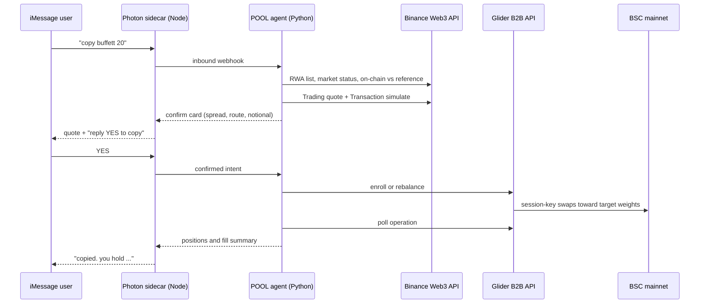

# POOL — Technical Requirements

Working name: **POOL**. An iMessage product that lets someone copy a tokenized-stock pilot on BNB Smart Chain, the way Autopilot lets someone copy a portfolio, except the thing being copied is a published on-chain allocation, not a celebrity's brokerage account.

Status: build spec for the BNB Hack: Tokenized Stocks Edition. Written 4 Oct 2026. Submission lock is **Sunday 11 Oct 2026, 12:00 UTC**.

This is the spec to build against. It is not a pitch deck.

## 1. Verdict

Ship a working iMessage agent that can list pilots, show BSC tokenized-stock prices against the US reference price, take an explicit copy confirmation, and put a small live allocation into Ondo stock tokens on BSC mainnet. Glider holds the copy relationship (strategy, enrollment, rebalance). Binance Web3 APIs are the research, quote, and simulation layer the hackathon scores. Photon is the only user interface.

Do not try to clone Autopilot's brokerage mirror. Glider does not stream anyone's brokerage fills, and inventing that would be a fake demo. What Glider actually sells, in their own words, is that investors copy allocations and trades into their own wallets. That is the product, and it is enough to win if the weekend-price guard and the iMessage confirm flow are real.

LangChain is optional. A Python tool router is the brain. Photon send/receive is TypeScript, so Python does not talk to iMessage directly.

## 2. Hackathon constraints that shape the build

Source: [BNB Hack: Tokenized Stocks Edition](https://www.bnbchain.org/en/hackathons/tokenized-stocks).

| Rule | Consequence for POOL |
| --- | --- |
| Submissions lock Sun 11 Oct 2026, 12:00 UTC | Feature freeze Saturday night. Sunday morning is video, repo, DX report, submit. |
| At least one of bStocks, Ondo, or xStocks must be central | Ondo on BSC is the one Glider documents. Do not promise bStocks or xStocks through Glider until an asset ID validates. |
| Spot only. Perps out. | No leverage, no short, no prediction markets in the demo path. |
| BSC mainnet only | Chain id `56`. Testnet is for dry-run simulation, not the video. |
| Dry-run with the Transaction API, then demo with a few dollars | Every live swap is simulated first. The video uses a funded demo wallet, not a mock. |
| Must use one or more Binance Web3 API modules | RWA Data, Trading quote, and Transaction simulate are in the critical path, not a sidebar. |
| Both the project and the Developer Experience Report are mandatory | Miss either and the entry is not scored. The report is 25% and AI-fluff is rejected. |
| Agents scored on build quality, not PnL | A correct refuse-to-trade is a better demo than a lucky fill. |
| Repo, demo, and deployed link must stay up through judging (through 23 Oct) | Do not deploy only on a laptop that sleeps. |

Prizes: $6k / $4k / $3k / $2k / $1k, plus $2k Best Use of Agentic Wallet and $2k Best Use of BNB Agent Studio. A main place and a special can both be won. Tie-break is depth of Web3 API usage, then the feedback report.

Judging:

| Criterion | Weight | What we optimize |
| --- | --- | --- |
| Technical implementation | 30% | Live mainnet path, three Binance modules, Glider enrollment, errors handled, operation polling. |
| Creativity | 25% | Copy-trading over iMessage, plus a hard stop when the on-chain price has drifted from the reference while the US market is shut. That is the prompt on the hackathon page. A generic Telegram swap bot loses this. |
| Developer Experience Report | 25% | A running friction log from the first API call. Specific URLs, error codes, latencies, liquidity. Written by us, not generated. |
| Product quality | 20% | A non-crypto person can text a pilot and understand what they are about to buy. Confirm before any swap. Plain English. No seed phrase in the chat. |

Eligibility gate, before any account is created: this hackathon is not open to residents of, or persons located in, the United States, Canada, the Netherlands, the United Kingdom, Japan, Iran, Cuba, North Korea, Crimea, Donetsk, or Luhansk, or anyone on a sanctions list. Confirm you can register before spending the week on this. Registration does not waive that.

## 3. Product

### How she talks

She is one LLM agent with tool access, not a keyword router. No `pilots` / `mag7` command tree. The user talks in plain English ("who can I copy?", "put me on the Pelosi one with twenty bucks", "what's moving today, should I do anything?") and she replies in a normal human tone, short texts, one idea per message. Tools feed her facts (pilots, prices, positions, news). She never invents a price, a fill, or a filing. Money still only moves through the confirm flow in section 6.

### What the user does

They text POOL on iMessage. First run, she introduces the pilots:

- "here are the people you can copy: pelosi, buffett, plus our ai-chips basket. which one do you want?" The user picks in words. She confirms the pick and the amount, quotes it, and asks for an explicit yes.
- After that she keeps copying that pilot: when the pilot publishes a new version she texts the follower before the next rebalance ("pelosi filing just landed, adding X, trimming Y — you're in, reply SKIP to sit this one out").
- Anytime: "how's my portfolio?" returns live positions, value, and next rebalance. "what's happening with NVDA?" triggers research: latest news plus on-chain vs reference price, then a suggestion, never an order, until the user says take it.
- "stop" pauses automation. "cash out" starts the signed withdrawal flow. She never silently liquidates.

Pilots are named after public figures but labeled honestly: "Pelosi-style (from STOCK Act disclosures)", "Buffett-style (from 13F + Buffett-portfolio filter)". Never "Nancy Pelosi is trading for you". The chat and the README both say filings are delayed and this is not investment advice.

### What "copy" means on this stack

1. A pilot is a Glider strategy: CAIP-19 asset weights that sum to 100, plus a rebalance schedule.
2. A follower is a Glider portfolio: one user, one strategy, one BSC smart account they own.
3. When the pilot publishes a new strategy version, enrolled portfolios pick it up on the next rebalance. POOL notices the version bump and texts the follower before that run.
4. Glider discovery (`curated`, `top_performing`) can surface other people's public strategies. Our own three pilots do not wait on Glider editorial placement.

This is allocation-copy, on a schedule, not fill-by-fill mirror of a brokerage. Say that in the demo. There is no live feed of anyone's brokerage: Pelosi disclosures land 30–45 days late under the STOCK Act, Buffett 13Fs land 45 days after quarter-end. So a "celebrity copy" is a pilot whose weights we update from those filings plus the Binance sector filters, published as a new Glider strategy version that followers pick up on rebalance. The researcher proposes the weight change, the pilot owner approves it, Glider executes it. Judges who know Autopilot will respect the distinction. Judges who think we faked a live brokerage feed will not.

### Research and suggest loop

A background worker, not the chat agent, does the reading. Every few hours it pulls filings and news (STOCK Act disclosures, 13Fs, earnings, tokenized-stock news), diffs them against current pilot weights, and drafts a rebalance note with sources. The chat agent turns that note into a suggestion when the user asks "what's moving" or when a pilot update is pending: what changed, why, what she'd do, and the question back to the user. She suggests. The user decides. The trade only happens on an explicit yes through the confirm flow.

### Portfolio management, not just analysis

"How am I doing" is answered from Glider positions plus the Binance Wallet API, in words first and numbers second: total value, per-leg value, drift from target, next rebalance. Managing means she can act on it: rebalance now, pause, change pilot, change amount, cash out. Each action goes through quote, spread guard, confirm, execute, poll, receipt.

### What we do not build

- Live mirror of a real manager's brokerage or real-time 13F feed. Filings are delayed by law; the demo says so.
- Perps, leverage, or "beat the market" claims. Suggestions are educational, and every suggestion ends with the user deciding.
- A web app as the primary UI. A tiny sign page is allowed because iMessage cannot sign EIP-712.
- Multi-chain. BSC only for the submission.
- Group-chat product, mini apps, and cold outreach. Photon free tier has no group API worth betting on, and mini apps want a Business line.
- Agent Studio as the execution runtime. Event credits are testnet-only (24h or 72h depending on host). Mainnet execution cannot live there. Skip it unless Saturday is free, and then only as an identity registration for the special prize. Do not bet the demo on it.

## 4. Architecture

Two processes, one database.

**Agent (Python, FastAPI).** Owns conversation state, pilot catalog, spread guard, Glider client, Binance client, and the friction log. Exposes `POST /hooks/spectrum` and `POST /internal/inbound` for the sidecar.

**iMessage sidecar (Node, `spectrum-ts`).** The only process allowed to call Photon. It receives the `app.messages` stream (or a webhook) and forwards a normalized JSON event to Python. Python calls back `POST /send` on the sidecar. There is no public HTTP send API on Photon, and there is no Python SDK. Do not spend a night discovering that.

Why not one language: Photon send, reactions, and polls are in `spectrum-ts`. The Binance connector we will actually call (`binance-web3-wallet`) and the rest of the product are Python, which is what you are building in. The sidecar should stay under 200 lines.

### Execution adapters

The agent talks to one interface, `Executor`.

| Adapter | Job | When it is on |
| --- | --- | --- |
| `QuoteAdapter` (Binance) | Always. Resolves ticker to BSC contract, market status, reference vs on-chain price, swap quote, simulate. | From the first hour. Public RWA list needs no key. |
| `GliderAdapter` | Creates the pilot strategy, enrolls the follower, starts automation, rebalances on version bump, reads positions and performance. | As soon as the B2B key and a signed enrollment exist. |
| `DirectSwapAdapter` (Binance Trading + a signer) | Fallback fill if Glider access is not approved in time. Same confirm card, same spread guard, one market buy into the basket via the aggregator. | Only if Glider is blocked by Wednesday. Still uses simulate-then-broadcast. |

Glider is the product. The direct swap is the insurance policy so a slow API-key review cannot kill the submission. If both exist by Friday, the video uses Glider, and the quote/simulate calls remain in the path so Binance usage is real.

### Spread guard

This is the feature that makes the project the hackathon's own thesis instead of a copy-trading clone.

Before any confirm card:

1. Read market status (open, closed, next open).
2. For each basket leg, read on-chain price and reference price. Remember Ondo's `multiplier`: reference price is token price divided by shares-per-token, not a raw compare.
3. If the US market is closed and any leg's absolute spread exceeds the pilot's threshold (start at 150 bps, make it a config), the card says the market is shut, names the worst leg, and requires a second explicit confirm ("copy anyway"). Default is to wait until `nextOpen`.
4. If a leg is paused for earnings, split, or dividend, that leg is dropped from the quote and the card says so. Do not silently reweight to 100 and trade.

Log every guard decision. A refused copy is a successful demo beat.

## 5. Stack

| Layer | Choice | Why |
| --- | --- | --- |
| Agent | Python 3.12, FastAPI, httpx, pydantic v2 | Matches how you are building. Official Binance connector wants 3.10+. |
| LLM | One tool-calling model as the whole personality. She holds the conversation, calls `list_pilots`, `explain_pilot`, `get_positions`, `research_ticker`, `propose_copy`, and formats replies like a person. She never calls Glider or Binance directly and never moves money; confirmed trades are plain Python behind the confirm token. System prompt: short human texts, no bullet walls, no "as an AI", one question at a time, always name the source ("per the May filing", "on-chain vs reference"). | The model is the voice. Tools that move money are plain Python, gated on a stored confirm token. |
| LangChain | Do not take the dependency for the MVP | It does not buy a judging point, and a tool-calling loop is 80 lines. Add it later only if a second agent needs memory you do not want to write. |
| iMessage | `spectrum-ts` cloud provider, Photon free tier | Free covers DMs, polls, 10 users. Enough for judges. Dedicated line is $250/month and is not required. Local Mac Messages is a dev fallback only: no polls, no effects, no group create. |
| Copy engine | Glider B2B `https://api.glider.fi/v2`, header `x-api-key` | Strategy, enroll, rebalance, positions, performance, sector exposure. Non-custodial Kernel smart account. Session key stays in Glider's KMS. We never see it. |
| Market and execution data | Binance Web3: RWA, Trading, Transaction. Package `binance-web3-wallet` | Required surface. Public RWA bapi routes exist, but the hackathon key is what you register for and what the DX report is about. |
| Chain | BSC mainnet, chain id 56 | Hackathon rule. |
| Settlement asset | BSC USDT `0x55d398326f99059fF775485246999027B3197955` | Glider redeems Ondo on BNB into this asset only. Do not liquidate Ondo to USDC on BSC. |
| Database | SQLite | One file, no ops. |
| Host | One small VM with a public HTTPS URL, kept up through 23 Oct | Photon webhooks need a URL. A sleeping laptop fails judging. |

Secrets, never in the repo and never in iMessage: `GLIDER_API_KEY`, `BINANCE_API_KEY`, `BINANCE_API_SECRET`, `SPECTRUM_PROJECT_ID`, `SPECTRUM_PROJECT_SECRET`, `SPECTRUM_WEBHOOK_SECRET`, demo owner private key. The demo key signs enrollment and withdrawals only. It does not sit in the agent process that talks to the model.

## 6. External contracts we depend on

### Glider

Base: `https://api.glider.fi/v2`. Key from [console.glidercloud.dev](https://console.glidercloud.dev/). Scopes: `strategies:read`, `strategies:write`, `enroll:write`, `portfolios:read`, `portfolios:write`, `portfolios:withdraw`.

| Step | Call |
| --- | --- |
| Confirm the key | `GET /whoami` |
| Create a pilot | `POST /strategies` with CAIP-19 weights summing to `"100"`, interval or cron schedule, swap prefs (`slippageBps`, `thresholdUsd`) |
| Publish a weight change | strategy version publish. Enrolled portfolios adopt it on next rebalance. |
| Browse others | `GET /discovery/strategies?collection=curated` or `top_performing` |
| Enroll | `POST /enroll/signature`, user signs, `POST /enroll` with the payload unchanged. Returns `portfolioId` and smart accounts. |
| Fund | No deposit builder. Transfer USDT to the BSC smart account (`depositAccountId` if present). Then `GET /portfolios/{id}/positions`. |
| Run | `POST /portfolios/{id}/start`, then `POST /portfolios/{id}/rebalance`. Poll `GET /portfolios/{id}/operations/{operationId}` every 2–5s until `completed`, `failed`, or `cancelled`. |
| Read | `/positions` (30s cache), `/performance`, `/sector-exposure` |
| Exit | `/withdraw/signature` then `/withdraw`. Auth expires in 10 minutes. Ondo exits use `/liquidate-all` and must settle to BSC USDT. |

Asset IDs are CAIP-19, for example `eip155:56/erc20:0x...`. Do not hardcode a chain list. If chain 56 is not enabled on the tenant, enrollment returns `400 API_400` and `error.details` names the rejected chain. That is a day-one check, not a surprise on Friday.

Enrollment is two-stage and user-signed (ECDSA or ERC-1271). The agent relays the signable message. It never receives Glider's automation key. For the hackathon video, the demo owner wallet signs once. A judge does not need to create a wallet if the video shows a second phone texting the already-enrolled demo account, and the repo documents how to enroll another owner.

Idempotency: reuse the stage-two anchor and the exact signed body. A 409 `API_007` means in progress. A 409 `API_008` means the key was reused with a different body. Do not invent a new body and retry.

### Binance Web3

Register at the [developer portal](https://web3.binance.com/en/dev-portal) and to the hackathon form so the elevated limits apply. Official Python client: `pip install binance-web3-wallet` (`binance_sdk_web3_wallet`).

Use these, and write down the first successful call time for the DX report:

| Module | Use in POOL |
| --- | --- |
| RWA Data | Token list by platform. `type=1` Ondo, `type=2` xStocks-style, `type=3` bStock. Ticker, BSC contract, multiplier. Market status and next open. Per-asset pause reason (earnings, dividend, split). Company profile and attestation URL. On-chain price vs reference. |
| Trading API | Quote the basket against BSC USDT before confirm. Show route and slippage. MEV protection on if we broadcast. |
| Transaction API | Simulate every broadcast. The video can show a failed simulation being refused. |
| Wallet API | Demo-wallet balances, so "status" does not depend only on Glider's 30s cache. |

Public list used by Binance's own skill, no key, useful tonight:

`GET https://www.binance.com/bapi/defi/v1/public/wallet-direct/buw/wallet/market/token/rwa/stock/detail/list/ai?type=1`

Filter `chainId=56`. A bare ticker can exist as `TSLAon`, `TSLAx`, and a bStock. POOL defaults to the Ondo BSC contract and says so. It does not guess.

Token is not one share. `referencePrice = onChainPrice / multiplier`. Get this wrong and the spread guard fires on every name.

### Photon

Cloud provider, not the local Mac adapter, for anything a judge will text.

- Dashboard: project id, project secret, webhook signing secret.
- Sidecar: `spectrum-ts` with `imessage.config()`. Tokens renew at 80% of TTL if project id and secret are set.
- Inbound: either the SDK message stream, or a signed webhook at `https://spectrum.photon.codes` (`POST /projects/{id}/webhooks/`). Verify `v0:{timestamp}:{rawBody}` HMAC. Ack 2xx immediately. Dedupe on message id.
- Outbound: `space.send` from the sidecar only.
- Free tier: shared numbers, up to 10 users, DMs, polls. Judges text the number we print in the README. Shared numbers mean each new sender may hit a fresh line. Document that. Do not promise one stable public number unless we pay for a dedicated line.

Conversation rules the model cannot override:

- No swap, enroll, rebalance, or withdraw without a confirm token issued by Python in the last 10 minutes, bound to phone + pilot + notional + quote id.
- Notional cap on the demo account: $25 per copy, $100 total. Hardcoded.
- The model may explain. It may not invent prices, fills, or performance. Those strings come from tool results only.

## 7. Data model

SQLite, four tables.

- `pilots` — id, display name, disclaimer, glider_strategy_id, version, schedule, weight JSON, spread_limit_bps, source (`ours` or `discovery`).
- `users` — phone, owner address, created_at. One row per iMessage sender.
- `copies` — user id, pilot id, glider_portfolio_id, smart_account CAIP-10, status (`quoted`, `confirmed`, `enrolled`, `funded`, `running`, `paused`, `failed`), last_seen_version.
- `events` — ts, kind (`api`, `guard`, `user`, `op`), system, latency_ms, status, note. This table is the DX report's source, not a debug leftover.

No positions table. Positions are read from Glider at reply time.

## 8. Pilot catalog for the demo

Three pilots, all Ondo-on-BSC, weights in USDT terms, daily rebalance, slippage 100 bps to start (tokenized-stock books are thin; 30 bps will fail and that failure belongs in the DX report).

| Pilot | Intent | How weights are chosen |
| --- | --- | --- |
| Pelosi-style | The copy-trading headline | Largest recent STOCK Act disclosure buys that have a BSC Ondo contract and are not paused. Updated when new filings land. Labeled "from public disclosures, delayed". |
| Buffett-style | The trust basket | Names from the 13F plus the Binance Buffett-portfolio filter with the tightest typical spread. This is the pilot the spread guard is demonstrated on. |
| AI Chips | Thematic | NVDA plus the other AI-chip names the RWA sector filter returns, capped at 6 legs so quotes finish. |

Weights are computed by a script from the live RWA list, checked in as `pilots/seed.json`, and pushed with `POST /strategies`. If a ticker has no BSC Ondo contract, it is omitted and the README says so. Do not backfill with an Ethereum contract. Wrong chain, failed enroll.

Rebalance schedule: daily, not every block. A hackathon wallet cannot pay for chatter, and Glider's value is the version bump, not HFT.

## 9. Build plan

Tonight is accounts and a vertical slice that does not move money. The live copy lands by Wednesday so Thursday and Friday are failure cases, not first contact.

### Tonight, before more code

Do these in order. Each one can block a later day.

1. Confirm eligibility, then register: https://forms.gle/NEmy3FxYc4f5Dua47
2. Apply for a Web3 API key: https://web3.binance.com/en/dev-portal
3. Join the builder Telegram: https://t.me/+MhiOLT0YUnlmNWFk
4. Request a Glider B2B key: https://console.glidercloud.dev/ — ask for chain 56 and the scopes in section 6. Ask explicitly whether Ondo BSC asset IDs pass `POST /strategies` validation.
5. Create a Photon project. Copy project id and secret. Provision the free iMessage line. Send yourself one message from the sidecar before writing agent code.
6. Fund a fresh BSC wallet with a few dollars of BNB and about $30 of USDT. This wallet is the demo owner. Write the address down. Do not reuse a personal wallet.
7. Open `docs/dx-log.md` and record, from this point, every call: URL, status, latency, the sentence that confused you. This is 25% of the score.

### Tonight, code

- Sidecar echoes a text to Python and Python replies through the sidecar. One round trip on your phone.
- Python pulls the public Ondo BSC list and prints Mag7 availability. That becomes `pilots/seed.json`.
- No LLM yet. Three hardcoded commands are enough to prove the pipe: `pilots`, `mag7`, `quote mag7 20`.
- Quote path calls RWA status and, if the key exists, Trading quote. If the key does not exist yet, return the price card and a clear "quote pending key" line. Do not fake a quote.

### By Wednesday

- Glider `whoami`, create the three strategies, enroll the demo owner on chain 56, transfer $20 USDT, start, rebalance, poll to `completed`, reply with positions in iMessage.
- Spread guard in front of confirm. One recorded case where the guard holds a copy.
- Transaction simulate on any direct broadcast. If Glider is the only sender, still simulate a representative swap and keep the response in the DX log so the module is actually used.
- Confirm token. The word "yes" does nothing unless a quote is pending.

### By Friday

- Version bump: change one weight, publish, text the follower, trigger rebalance, show the new positions.
- Pause and a withdraw signature prepared, even if the video does not broadcast the withdraw.
- Failure paths with real copy: insufficient USDT, paused ticker, Glider 400 on a bad asset id, operation `failed`. Each one replies in English and writes an event row.
- README a judge can follow without you in the room: text this number, say this, expect this. Plus a second path if the line is down (scripted cast of the same API calls).

### Saturday night

Freeze. Record the four-minute video on a phone: market-closed guard, confirm, live fill, status, pilot update. No slides.

### Sunday before 12:00 UTC

Submit the repo, the deployed link, the video, and the DX report. Form: https://forms.gle/yToDUzaDMwWnq6R6A. Report template: https://forms.gle/EUQ39xf54GHjC2ys5. Leave the service running.

## 10. Developer Experience Report

Start the log tonight. Write the report Sunday morning from the log, in your own sentences. They have said perfunctory or AI-generated reports will not be accepted. AI-assisted code is fine.

The report has to cover, with specifics:

- Minutes from opening each doc set to the first successful call, and which page was wrong or missing.
- Error strings that did not say what to fix. Include the code (`API_400`, `API_007`) and the endpoint.
- Latency of quote, simulate, enroll, and rebalance poll. One table.
- How Ondo on BSC actually behaved: depth, slippage versus the 100 bps pref, what the book looked like with the US market shut, whether bStock or xStock for the same ticker was even acquirable. If we never got a Glider asset id to validate, that is a finding, not a gap to hide.
- The AI stack section: model used, what it was allowed to call, where it hallucinated a price and how the tool gate stopped it, what we would not put behind a tool call.
- If you owned the developer platform, the one change that would have made the first call succeed on the first try. One change, not a wishlist.

## 11. Risks

| Risk | What we do |
| --- | --- |
| Glider key or chain-56 entitlement is slow | DirectSwapAdapter is specified now, not invented on Thursday. Video still shows Binance quote, simulate, and a live BSC fill. |
| Ondo BSC symbols fail Glider validation | Drop that leg, record the asset id and the error body. Three working names beat seven broken ones. |
| Thin weekend books blow the slippage pref | Raise `slippageBps` only after a recorded failure. The failure is the DX content. |
| Photon shared line confuses a judge | README says "text this number from the phone you want the reply on" and we watch the sidecar during judging week. |
| Someone reads the demo as unlicensed brokerage | Copy is into the user's own smart account, amounts are capped, pilots are labeled model portfolios, no performance promise in the chat, restricted-jurisdiction list is in the README. This is a hackathon demo, not a public launch. |
| LLM confirms a trade the user did not mean | Model has no executor credentials. Confirm token is checked in Python. |
| Agent Studio looks like free points | Testnet runtime cannot satisfy "BSC mainnet only". Chase Agentic Wallet only if the direct-swap signer is the `baw` CLI and the skill path is real. Otherwise leave the special prize. A broken extra integration costs technical points. |

## 12. Definition of done

A judge can, without us:

1. Open the repo and see how to text the agent.
2. Text `pilots` and get three baskets with live on-chain vs reference prices.
3. Watch, in the video at minimum, a copy that either fills on BSC mainnet or is refused by the spread guard with the numbers on screen.
4. See a pilot weight change land in the follower portfolio.
5. Read a DX report that names endpoints, errors, and latencies we actually hit.

If item 3 is only a simulated transaction, we are submitting a weaker project. A few dollars on mainnet is the bar they set. Hit it.
